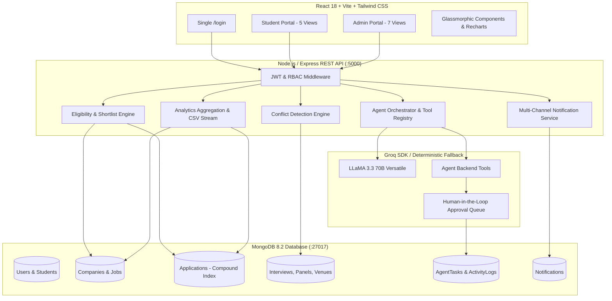

# CampusPilot 🎓
### Autonomous AI-Powered Campus Placement Management & Interview Coordination Platform

CampusPilot is an enterprise-grade, agentic placement management system built for higher-education universities and colleges. Powered by the MERN stack (MongoDB, Express, React, Node.js) and Groq SDK (`llama-3.3-70b-versatile`), CampusPilot unifies student placement workflows, automated company job postings, conflict-free interview coordination, multi-channel notification dispatch, and real-time executive analytics with strict **Human-in-the-Loop** administrative safeguards.

---

## 🌟 Key Highlights & Architectural Pillars

- **Unified Single-Sign-On Authentication**: Single login page (`/login`) for both students and placement officers, resolving access dynamically via role-based access control (RBAC). Client-side self-registration strictly locks the role to `student` to prevent privilege escalation.
- **Autonomous AI Placement Agent**: Powered by Groq's high-throughput LLaMA 3.3 70B engine (`llama-3.3-70b-versatile`) with seamless deterministic fallback. The agent parses unstructured job descriptions, verifies candidate eligibility, auto-generates candidate shortlists, schedules conflict-free interview slots, and drafts campus announcements.
- **Strict Human-in-the-Loop Safeguards**: AI agent plans are staged in an approval queue (`Waiting for Approval`). Database mutations (shortlisting, interview bookings, job postings) are only executed upon explicit administrative authorization.
- **Deterministic Interview Conflict Engine**: Employs an exact interval overlap algorithm ($\max(S_A, S_B) < \min(E_A, E_B)$) preventing candidate double-booking, faculty evaluation panel double-booking, and physical room double-booking with instant HTTP 409 rejections.
- **Multi-Channel Notification Dispatcher**: Real-time in-app notification feed, simulated email/SMS receipts, instant unread counter badges, and category filtering (Announcements, Interviews, Offers, Alerts).
- **Placement Analytics & Reporting Dashboard**: Interactive visualizations built with Recharts (branch distribution, salary package tiers, skill demand vs. batch readiness matrix, monthly recruitment progression), and streaming CSV export.

---

## 🎨 Design System & Aesthetic Tokens

CampusPilot features an advanced **soft neumorphic and glassmorphic** user interface with seamless Dark Mode support:

| Token / Layer | Hex Value / Styling | Purpose |
| :--- | :--- | :--- |
| **Primary Background (Light)** | `#EAF8FF` | Soft, serene ambient background |
| **Primary Background (Dark)** | `#071A2B` | Deep executive midnight slate |
| **Card / Surface (Light)** | `#FFFFFF` with glassmorphic border `rgba(0,158,173,0.12)` | Soft neumorphic embossed card |
| **Card / Surface (Dark)** | `#102A43` with border `rgba(56,189,248,0.15)` | Sleek floating dark panel |
| **Primary Accent (Teal)** | `#009EAD` | Primary interactive buttons, badges, active tabs |
| **Secondary Accent (Cyan)** | `#00B8C7` | Gradient transitions, glow highlights |
| **Vibrant Highlight (Sky)** | `#38BDF8` | Status indicators, hover states, charts |
| **Corner Radius** | `rounded-2xl` (16px) & `rounded-3xl` (24px) | Modern soft geometric curves |

---

## 🏛️ System Architecture



---

## 📑 Portals & Core Modules

### 1. Student Portal (`/student/*`)
- **Dashboard (`/student/dashboard`)**: Active drive alerts, upcoming interview counter, overall eligibility status, application tracker, and direct quick-action cards.
- **My Profile (`/student/profile`)**: Academic telemetry (CGPA, active backlogs, graduation year), technical and soft skills tag manager, social/GitHub/portfolio links, and verified resume uploader.
- **Jobs & Applications (`/student/jobs`)**: Filterable job board with live **Instant Eligibility Verification**, comprehensive round descriptions, package tier badges (Dream/Super Dream), and application status tracker (`Applied` → `Shortlisted` → `Technical Round` → `Offered`).
- **Interviews & Notifications (`/student/interviews`)**: Confirmed interview timetable cards with venue room, faculty panel, date/time, and real-time status feedback scores.
- **AI Career Assistant (`/student/ai-assistant`)**: Direct conversational career advisor providing personalized resume optimization tips, mock technical interview questions, and placement drive preparation strategies.

### 2. Administrative Portal (`/admin/*`)
- **Dashboard (`/admin/dashboard`)**: Placement statistics (Total Placed %, Highest CTC, Average CTC, Active Drives), pending approval queue counter, and quick-action shortcuts.
- **Companies & Jobs (`/admin/companies`)**: Full CRUD management of partner enterprises and job requisitions, with dynamic eligibility criteria builder (CGPA threshold, allowed branches, max backlogs).
- **Candidates (`/admin/candidates`)**: Searchable student directory with branch filters, verified placement status tags, CGPA sorting, and direct application history inspection.
- **AI Placement Agent (`/admin/agent`)**: Autonomous agent control center. Placement officers can dispatch natural language commands (e.g. *"Shortlist eligible CSE candidates for Google Cloud Architect"*, *"Schedule technical interviews for shortlisted Amazon candidates"*), inspect step-by-step reasoning workflows, and approve or reject proposed operations.
- **Interview Coordination (`/admin/coordination`)**: Timetable manager with pre-flight clash detection. Prevents candidate, panel, and room double-booking. Includes panel evaluation drawer to submit 1-10 scores, outcomes (`Selected`, `Rejected`, `Waitlisted`), and interview feedback.
- **Notifications & Broadcasts (`/admin/notifications`)**: Multi-channel broadcast composer supporting priority levels (`Normal`, `High`, `Urgent`), branch/batch targeting, and simulated SMS/Email receipts.
- **Analytics & Reporting (`/admin/analytics`)**: Department-wise placement distribution, CTC package tiers, skill demand vs. readiness matrix, monthly recruitment progression, and one-click CSV report export.

---

## 🤖 AI Placement Agent Tools & Safe Orchestration

The AI Placement Agent interacts with the backend through controlled deterministic tools:

1. `analyzeJobDescription`: Parses unstructured JD text to extract title, CTC package, minimum CGPA, eligible branches, and required technical skills.
2. `checkEligibility`: Evaluates student academic metrics against job criteria and returns pass/fail breakdowns.
3. `shortlistCandidates`: Filters eligible candidates, matches candidate skill tags against job requirements, and ranks top applicants.
4. `scheduleInterviews`: Automatically pairs shortlisted candidates with available faculty panels and rooms, generating non-overlapping 30-minute interview slots.
5. `draftAnnouncement`: Generates formatted campus placement announcements tailored for student broadcasts.

### Human-in-the-Loop (HITL) Execution Workflow
```
[Admin Natural Language Prompt]
              │
              ▼
[Agent Reasoner & Tool Execution]
              │
              ▼
[AgentTask Created: 'Waiting for Approval']
              │
    ┌─────────┴─────────┐
    ▼                   ▼
[Admin Rejects]     [Admin Approves & Executes]
    │                   │
    ▼                   ▼
Task marked 'Cancelled' Task marked 'Completed'
                        Database Mutations Applied:
                        - Candidates Shortlisted
                        - Non-conflicting Interview Slots Booked
                        - Campus Notification Broadcasted
```

---

## 🛠️ Technology Stack

| Layer | Technologies |
| :--- | :--- |
| **Frontend** | React 18, Vite, Tailwind CSS, Lucide React, Framer Motion, Recharts, Canvas Confetti |
| **Backend** | Node.js (ES Modules), Express.js, JSON Web Tokens (`jsonwebtoken`), `bcryptjs`, `cors`, `helmet`, `express-rate-limit` |
| **Database** | MongoDB 8.2 (Community Edition), Mongoose ODM 8.x |
| **AI / LLM** | Groq SDK (`groq-sdk`), Meta LLaMA 3.3 70B (`llama-3.3-70b-versatile`), Deterministic Fallback Engine |
| **Testing** | Native Node.js Test Runner (`node:test`, `node:assert/strict`) |

---

## 📂 Project Structure

```
c:\CSE\Hackathon/
├── backend/
│   ├── data/                   # Local MongoDB data directory
│   ├── src/
│   │   ├── config/             # DB connection, Groq client, environment variables
│   │   ├── controllers/        # REST route handlers (Auth, Jobs, Interviews, Agent, etc.)
│   │   ├── middleware/         # JWT verification, RBAC, error handling, rate limiting
│   │   ├── models/             # 11 Mongoose Schemas (User, Student, Job, Interview, etc.)
│   │   ├── routes/             # Express API routing definitions
│   │   ├── services/           # Agent orchestrator, backend tools, seed script
│   │   ├── utils/              # Deterministic slot conflict detection algorithms
│   │   └── app.js              # Express app bootstrap
│   ├── test/                   # 8 Automated Test Suites (84 Tests Total)
│   │   ├── agent.test.js
│   │   ├── analytics.test.js
│   │   ├── auth.test.js
│   │   ├── coordination.test.js
│   │   ├── e2e.test.js         # Master 11-step end-to-end placement verification
│   │   ├── health.test.js
│   │   ├── notification.test.js
│   │   └── placement.test.js
│   └── package.json
│
├── frontend/
│   ├── src/
│   │   ├── components/         # Navbar, Sidebar, StatCard, Modal, StatusBadge, etc.
│   │   ├── context/            # AuthContext, NotificationContext, ThemeContext
│   │   ├── pages/
│   │   │   ├── admin/          # 7 Admin views (Dashboard, Jobs, Agent, Coordination, etc.)
│   │   │   ├── student/        # 5 Student views (Dashboard, Jobs, Interviews, Profile, etc.)
│   │   │   └── Login.jsx       # Unified single-sign-on auth view
│   │   ├── services/           # Axios API services
│   │   ├── App.jsx             # React Router configuration
│   │   └── main.jsx
│   ├── tailwind.config.js      # CampusPilot theme palette tokens
│   ├── vite.config.js          # Vite configuration with proxy to :5000
│   └── package.json
│
└── README.md
```

---

## 🔑 Seeded Demo Credentials

| Role | Email | Password | Details |
| :--- | :--- | :--- | :--- |
| **Placement Administrator** | `admin.placement@campus.edu` | `Password@123` | Full access to all 7 Admin Portal modules & AI Agent |
| **Student (CSE)** | `rahul.verma@campus.edu` | `Password@123` | CGPA 8.7, Full Stack, 2 Active Applications |
| **Student (CSE - Cloud)** | `sneha.patel@campus.edu` | `Password@123` | CGPA 9.2, Cloud & Distributed Systems |
| **Student (IT)** | `aarav.sharma@campus.edu` | `Password@123` | CGPA 7.9, DevOps & Python Developer |
| **Student (ECE)** | `rohan.d@campus.edu` | `Password@123` | CGPA 8.1, Embedded Systems & IoT |
| **Student (Data Science)** | `pooja.nair@campus.edu` | `Password@123` | CGPA 9.0, Machine Learning & Analytics |

---

## 🚀 Quickstart & Setup Guide

### 1. Prerequisites
- **Node.js**: v18.x or v20.x+
- **MongoDB**: v7.0 or v8.x installed locally (or MongoDB Atlas URI)

### 2. Start Local MongoDB Daemon
```powershell
mongod --dbpath "C:\CSE\Hackathon\backend\data" --port 27017
```

### 3. Backend Setup
```powershell
cd backend
npm install

# Seed the database with campus enterprise data (Companies, Jobs, Students, Panels, Venues)
npm run seed

# Run Backend API Server (Port 5000)
npm run dev
```

### 4. Frontend Setup
```powershell
cd frontend
npm install

# Run Frontend Development Server (Port 5173)
npm run dev
```

### 5. Access the Platform
- **Frontend App**: [http://localhost:5173](http://localhost:5173)
- **Backend API Telemetry**: [http://localhost:5000/api/health](http://localhost:5000/api/health)

---

## 🧪 Comprehensive Verification Suite

CampusPilot includes a rigorous, production-grade test suite covering every phase of the project:

```powershell
cd backend
node --test test/*.test.js
```

### Test Suite Summary:
```
✔ Phase 3: Backend Foundation & Database Verification (5 tests)
✔ Phase 4: Authentication & Role Authorization (9 tests)
✔ Phase 5: Core Placement Management (9 tests)
✔ Phase 6: AI Placement Agent & Orchestration (9 tests)
✔ Phase 7: Interview Coordination & Panel Scheduling (15 tests)
✔ Phase 8: Notification & Communication Engine (13 tests)
✔ Phase 9: Placement Analytics & Reporting Engine (7 tests)
✔ Phase 10: End-to-End Placement Lifecycle Master Verification (12 tests)
✔ Health Endpoint Telemetry (5 tests)
─────────────────────────────────────────────────────────────────
Total Passed: 84 / 84 tests (100% Pass Rate, 0 Failures)
Total Execution Duration: ~12.5 seconds
```

---

## 🔒 Security Hardening

- **Privilege Escalation Defense**: Self-registration enforces `role = 'student'`. Administrative credentials can only be provisioned via administrative CLI scripts or direct database management.
- **Duplicate Prevention**: Mongoose unique compound index `{ studentId: 1, jobId: 1 }` prevents concurrent duplicate job applications.
- **SQL / NoSQL Injection Immunity**: Mongoose parameterized object schema sanitization.
- **Brute Force Mitigation**: Tiered `express-rate-limit` guards on authentication endpoints (5 requests/15 mins per IP) and API endpoints (100 requests/15 mins per IP).
- **Audit Trails**: Every administrative mutation, status change, and AI agent approval is captured in immutable `ActivityLog` collections.

---

## 📄 License
CampusPilot is built under the MIT License. Developed for University Campus Placements & Interview Coordination.

